# DER — Comi-Rapi

## 1. Introducción

Este documento describe el **Diagrama Entidad-Relación (DER)** del proyecto **Comi-Rapi**.

Deriva directamente del modelo de dominio aprobado en `docs/modelo-dominio.md` (fuente de verdad) y del enunciado funcional `docs/enunciado.md`. Representa la estructura de datos prevista para la implementación con **PostgreSQL + Sequelize**, sin incluir todavía código, modelos ORM, migraciones ni rutas.

`docs/historico/analisis-inicial.md` es material histórico y no se utiliza para definir este DER.

## 2. Entidades

El DER contempla las **30 entidades** del modelo actual (las 23 del modelo de dominio más `HorarioSucursal`, `PasswordResetToken`, `DistanciaRuta`, `Notificacion`, `Ingrediente`, `IngredienteStock` y `ProductoIngrediente`). Para cada una se indica su PK, atributos principales, FKs y restricciones relevantes.

### 2.1 Usuario

| Atributo          | Tipo de dato                                             | Notas                                              |
| ----------------- | -------------------------------------------------------- | -------------------------------------------------- |
| `id`              | `INTEGER`                                                | PK                                                 |
| `nombre`          | `STRING`                                                 |                                                    |
| `apellido`        | `STRING`                                                 |                                                    |
| `email`           | `STRING`                                                 | UNIQUE                                             |
| `password`        | `STRING`                                                 | hash (posterior)                                   |
| `telefono`        | `STRING`                                                 |                                                    |
| `rol`             | `ENUM('CLIENTE', 'ADMINISTRADOR', 'SUPERADMINISTRADOR')` |                                                    |
| `activo`          | `BOOLEAN`                                                |                                                    |
| `fechaNacimiento` | `DATEONLY`                                               | Opcional                                           |
| `fotoPerfilUrl`   | `STRING`                                                 | Opcional                                           |
| `sucursalId`      | `INTEGER`                                                | FK opcional → `Sucursal.id` (solo ADMINISTRADOR) |
| `createdAt`       | `DATE`                                                   |                                                    |
| `updatedAt`       | `DATE`                                                   |                                                    |

- PK: `id`
- UNIQUE: `email`
- FK opcional: `sucursalId → Sucursal.id`, `ON DELETE SET NULL`. Solo el ADMINISTRADOR tiene sucursal asignada (`CLIENTE` y `SUPERADMINISTRADOR` la dejan en `NULL`); lo garantiza el CHECK `chk_usuarios_sucursal_solo_admin`.
- `edad` es un atributo derivado/calculado a partir de `fechaNacimiento`; **no** se persiste en la base de datos.

### 2.2 Direccion

`Direccion` es la única entidad que almacena los datos de ubicación, tanto para un usuario como para una sucursal. Puede pertenecer a un usuario o a una sucursal, pero **no a ambos simultáneamente ni a ninguno**.

| Atributo       | Tipo de dato    | Notas                         |
| -------------- | --------------- | ----------------------------- |
| `id`           | `INTEGER`       | PK                            |
| `usuarioId`    | `INTEGER`       | FK opcional → `Usuario.id`  |
| `sucursalId`   | `INTEGER`       | FK opcional → `Sucursal.id` |
| `calle`        | `STRING`        | Obligatorio                   |
| `altura`       | `INTEGER`       | Obligatorio                   |
| `provincia`    | `STRING`        | Obligatorio                   |
| `departamento` | `STRING`        | Opcional (iteración 1-geo)   |
| `localidad`    | `STRING`        | Opcional (iteración 1-geo)   |
| `codigoPostal` | `STRING`        | Opcional (iteración 1-geo)   |
| `nomenclatura` | `STRING`        | Opcional (iteración 1-geo)   |
| `referencia`   | `TEXT`          | Opcional                      |
| `latitud`      | `DECIMAL(10,7)` | Opcional                      |
| `longitud`     | `DECIMAL(10,7)` | Opcional                      |
| `alias`        | `STRING`        | Opcional                      |
| `activa`       | `BOOLEAN`       |                               |

> **Nota de cambio (Iteración 1-geo):** se agregan `departamento` (unidad territorial intermedia según Georef: **partido** en Buenos Aires, **comuna** en CABA, departamento en el resto) y `nomenclatura` (dirección completa normalizada por Georef). `localidad` y `codigoPostal` pasan a ser **opcionales**: el backend determina la localidad a partir de la `localidad_censal` de Georef y el CP no se exige porque Georef no lo provee (ver `docs/reglas-negocio.md` §18). Ambos campos nuevos son inicialmente nullable para no romper las filas existentes; se completan al editar la dirección o mediante un backfill futuro.

- PK: `id`
- FK (opcional): `usuarioId → Usuario.id`, `ON DELETE RESTRICT`
- FK (opcional): `sucursalId → Sucursal.id`, `ON DELETE RESTRICT`
- CHECK: `CK_Direcciones_propietario` — exactamente uno de `usuarioId` / `sucursalId` debe estar informado (`("usuarioId" IS NOT NULL)::int + ("sucursalId" IS NOT NULL)::int = 1`)
- Obligatorios: `calle`, `altura`, `provincia` (NOT NULL; también validados en la API). Iteración 1-geo: `localidad` y `codigoPostal` pasaron a ser opcionales (NOT NULL retirado); el `departamento` (partido) se exige en la API cuando la provincia es Buenos Aires, pero no a nivel de persistencia. Antes de la alineación existía `ciudad`, renombrada a `localidad`.
- `latitud`/`longitud` son opcionales y **no se ingresan manualmente** (la API las rechaza): las calcula `geolocation_service` (Georef) a partir de los datos de la dirección. Ídem `provincia`/`calle`/`departamento`/`localidad`/`nomenclatura`: desde la Iteración 2 el backend los persiste **todos normalizados por Georef** al geocodificar (la `nomenclatura` queda como dato geográfico complementario; no se conserva la escritura original del usuario).

### 2.3 Sucursal

| Atributo   | Tipo de dato | Notas |
| ---------- | ------------ | ----- |
| `id`       | `INTEGER`    | PK    |
| `nombre`   | `STRING`     |       |
| `telefono` | `STRING`     |       |
| `activa`   | `BOOLEAN`    |       |

- PK: `id`
- FK: `Direccion.sucursalId → Sucursal.id` (relación `Sucursal 1:1 Direccion`, declarada en `Direccion`). `Sucursal` no almacena `direccion` ni coordenadas: esos datos quedan centralizados en `Direccion`.
- El horario de atención es estructurado: ver `HorarioSucursal` (§2.3.1). La antigua columna `Sucursales.horarios` se eliminó tras el backfill.

### 2.3.1 HorarioSucursal

| Atributo     | Tipo de dato | Notas                                   |
| ------------ | ------------ | --------------------------------------- |
| `id`         | `INTEGER`    | PK                                      |
| `sucursalId` | `INTEGER`    | FK → `Sucursal.id`                    |
| `diaSemana`  | `INTEGER`    | 1 = lunes … 7 = domingo (ISO-8601)    |
| `apertura`   | `TIME`       | hora real de apertura del local (HH:MM) |
| `cierre`     | `TIME`       | hora real de cierre del local (HH:MM)   |

- PK: `id`
- FK: `sucursalId → Sucursal.id`, `ON DELETE CASCADE`
- UNIQUE: `(sucursalId, diaSemana, apertura, cierre)` — se rechazan franjas exactamente duplicadas.
- CHECK: `CK_HorarioSucursales_dia` — `diaSemana` entre 1 y 7.
- Validación de servicio (`horarios_service.normalizarHorarios`): `apertura` y `cierre` son horas válidas, `apertura <> cierre` (una franja no puede durar cero) y las franjas no se repiten dentro del mismo día.
- Varias franjas por día y solapamientos permitidos: "abierta" es caer en cualquiera.
- `cierre <= apertura` representa una franja que **cruza la medianoche** (ej. 19:00–02:00) y pertenece al día de apertura.
- Sin franjas para un día = sucursal cerrada ese día. Para cerrar todo el local se usa `Sucursal.activa = false`, no la ausencia de franjas.
- `apertura`/`cierre` guardan el horario **real del local**. El corte de pedidos se **deriva** restando el parámetro global `margenCierreMinutos` (default 30): el local cierra 23:00 y la página deja de tomar pedidos 22:30.

### 2.4 Categoria

| Atributo      | Tipo de dato | Notas                                         |
| ------------- | ------------ | --------------------------------------------- |
| `id`          | `INTEGER`    | PK                                            |
| `nombre`      | `STRING`     | UNIQUE                                        |
| `descripcion` | `TEXT`       |                                               |
| `imagen`      | `STRING`     | ruta relativa en `public/imagenes/categorias` |
| `activa`      | `BOOLEAN`    |                                               |

- PK: `id`
- UNIQUE: `nombre`

### 2.5 Producto

| Atributo      | Tipo de dato                | Notas                 |
| ------------- | --------------------------- | --------------------- |
| `id`          | `INTEGER`                   | PK                    |
| `categoriaId` | `INTEGER`                   | FK → `Categoria.id` |
| `nombre`      | `STRING`                    |                       |
| `descripcion` | `TEXT`                      |                       |
| `precio`      | `DECIMAL(10,2)`             | precio vigente        |
| `imagen`      | `STRING`                    |                       |
| `activo`      | `BOOLEAN`                   |                       |
| `tipo`        | `ENUM('PRODUCTO', 'COMBO')` |                       |

- PK: `id`
- FK: `categoriaId → Categoria.id`
- Relación: `Producto 1:N ProductoIngrediente` (receta; sólo `tipo = PRODUCTO`)

### 2.6 ComboComponente

| Atributo     | Tipo de dato | Notas                |
| ------------ | ------------ | -------------------- |
| `id`         | `INTEGER`    | PK                   |
| `comboId`    | `INTEGER`    | FK → `Producto.id` |
| `productoId` | `INTEGER`    | FK → `Producto.id` |
| `cantidad`   | `INTEGER`    |                      |

- PK: `id`
- FK: `comboId → Producto.id` (producto tipo `COMBO`)
- FK: `productoId → Producto.id` (producto componente)
- UNIQUE: `(comboId, productoId)`

Implementado. `cantidad` es cuántas unidades del componente lleva **una** unidad
del combo, y no puede ser negativa (CHECK `CK_ComboComponentes_cantidad`).

### 2.7 OpcionGrupo

| Atributo        | Tipo de dato                | Notas |
| --------------- | --------------------------- | ----- |
| `id`            | `INTEGER`                   | PK    |
| `nombre`        | `STRING`                    |       |
| `tipoSeleccion` | `ENUM('UNICA', 'MULTIPLE')` |       |
| `minimo`        | `INTEGER`                   |       |
| `maximo`        | `INTEGER`                   |       |
| `obligatorio`   | `BOOLEAN`                   |       |
| `activo`        | `BOOLEAN`                   |       |

- PK: `id`

### 2.8 Opcion

| Atributo               | Tipo de dato    | Notas                         |
| ---------------------- | --------------- | ----------------------------- |
| `id`                   | `INTEGER`       | PK                            |
| `grupoId`              | `INTEGER`       | FK → `OpcionGrupo.id`       |
| `nombre`               | `STRING`        |                               |
| `precioAdicional`      | `DECIMAL(10,2)` |                               |
| `activo`               | `BOOLEAN`       |                               |
| `productoReferenciaId` | `INTEGER`       | FK opcional → `Producto.id` |

- PK: `id`
- FK: `grupoId → OpcionGrupo.id`
- FK (opcional): `productoReferenciaId → Producto.id`

### 2.9 ProductoOpcionGrupo

| Atributo     | Tipo de dato | Notas                   |
| ------------ | ------------ | ----------------------- |
| `id`         | `INTEGER`    | PK                      |
| `productoId` | `INTEGER`    | FK → `Producto.id`    |
| `grupoId`    | `INTEGER`    | FK → `OpcionGrupo.id` |

- PK: `id`
- FK: `productoId → Producto.id`
- FK: `grupoId → OpcionGrupo.id`
- UNIQUE: `(productoId, grupoId)`

### 2.10 Stock

| Atributo     | Tipo de dato | Notas                            |
| ------------ | ------------ | -------------------------------- |
| `sucursalId` | `INTEGER`    | PK (parte), FK → `Sucursal.id` |
| `productoId` | `INTEGER`    | PK (parte), FK → `Producto.id` |
| `cantidad`   | `INTEGER`    |                                  |
| `disponible` | `BOOLEAN`    |                                  |

- PK (compuesta): `(sucursalId, productoId)` — la combinación sucursal + producto debe ser única.
- FK: `sucursalId → Sucursal.id`
- FK: `productoId → Producto.id`

Implementado. `cantidad` no puede ser negativa (CHECK `CK_Stocks_cantidad`). La
cantidad de un combo se deriva de los componentes (§8) y no se carga a mano: el
backend la recalcula cada vez que cambia el stock de un componente, la receta o
la fila del combo. La fila existe para que el combo esté en el catálogo de la
sucursal y se pueda apagar con `disponible`.

### 2.10.1 Insumo (extensión implementada)

Catálogo corporativo de extras y condimentos con existencia propia. No es un
`Producto`: no tiene ficha, categoría, foto ni receta.

| Atributo | Tipo de dato    | Notas                                      |
| -------- | --------------- | ------------------------------------------ |
| `id`     | `INTEGER`       | PK                                         |
| `nombre` | `STRING`        | Obligatorio                                |
| `tipo`   | `ENUM`          | `extra` o `condimento`                     |
| `precio` | `DECIMAL(10,2)` | Obligatorio en extra; `null` en condimento |
| `activo` | `BOOLEAN`       | Baja lógica                               |

- UNIQUE: `(nombre, tipo)`.
- Los tipos `acompanar` y `personalizar` no se vinculan a insumos.

### 2.10.2 InsumoStock (extensión implementada)

| Atributo     | Tipo de dato | Notas                            |
| ------------ | ------------ | -------------------------------- |
| `sucursalId` | `INTEGER`    | PK (parte), FK → `Sucursal.id` |
| `insumoId`   | `INTEGER`    | PK (parte), FK → `Insumo.id`   |
| `cantidad`   | `INTEGER`    | `>= 0` (CHECK)                   |
| `disponible` | `BOOLEAN`    |                                  |

- PK (compuesta): `(sucursalId, insumoId)`.
- FK: `sucursalId → Sucursal.id`; `insumoId → Insumo.id` (borrado en cascada).
- CHECK: `CK_InsumoStocks_cantidad` (`cantidad >= 0`).
- Misma semántica que `Stock`: `disponible = false` equivale a 0 para la venta.
- `PersonalizacionElementos` y `PersonalizacionCategorias` agregan `insumoId`
  nullable (FK → `Insumo.id`, `ON DELETE SET NULL`), obligatorio en `extra` y
  `condimento`.

El detalle de reglas, endpoints y datos demo está en `docs/insumos.md`.

### 2.10.3 Ingrediente (extensión implementada)

Catálogo corporativo de materias primas que forman la receta de los productos.
No es un `Producto` ni un `Insumo`.

| Atributo       | Tipo de dato                           | Notas        |
| -------------- | -------------------------------------- | ------------ |
| `id`           | `INTEGER`                              | PK           |
| `nombre`       | `STRING`                               | Obligatorio  |
| `unidadMedida` | `ENUM('unidad', 'g', 'kg', 'ml', 'l')` | Obligatorio  |
| `activo`       | `BOOLEAN`                              | Baja lógica |

- UNIQUE: `nombre`.
- No hay conversión automática entre unidades.
- La `unidadMedida` no se puede cambiar si el ingrediente ya tiene stock o recetas.

### 2.10.4 IngredienteStock (extensión implementada)

| Atributo        | Tipo de dato    | Notas                               |
| --------------- | --------------- | ----------------------------------- |
| `sucursalId`    | `INTEGER`       | PK (parte), FK → `Sucursal.id`    |
| `ingredienteId` | `INTEGER`       | PK (parte), FK → `Ingrediente.id` |
| `cantidad`      | `DECIMAL(12,3)` | `>= 0` (CHECK)                      |
| `disponible`    | `BOOLEAN`       |                                     |

- PK (compuesta): `(sucursalId, ingredienteId)`.
- FK: `sucursalId → Sucursal.id`; `ingredienteId → Ingrediente.id` (borrado en cascada).
- CHECK: `CK_IngredienteStocks_cantidad` (`cantidad >= 0`).
- Misma semántica que `Stock`: `disponible = false` o la ausencia de fila equivale
  a 0 para el cálculo y la venta.
- Un ingrediente inactivo también equivale a 0.

### 2.10.5 ProductoIngrediente (extensión implementada)

Receta de un producto simple.

| Atributo        | Tipo de dato    | Notas                               |
| --------------- | --------------- | ----------------------------------- |
| `productoId`    | `INTEGER`       | PK (parte), FK → `Producto.id`    |
| `ingredienteId` | `INTEGER`       | PK (parte), FK → `Ingrediente.id` |
| `cantidad`      | `DECIMAL(12,3)` | `> 0` (CHECK)                       |
| `permiteQuitar` | `BOOLEAN`       | default `true`                      |

- PK (compuesta): `(productoId, ingredienteId)`.
- FK: `productoId → Producto.id`; `ingredienteId → Ingrediente.id` (borrado en cascada).
- CHECK: `CK_ProductoIngredientes_cantidad` (`cantidad > 0`).
- Sólo aplica a `Producto` con `tipo = PRODUCTO`; un `COMBO` no tiene receta de
  ingredientes.
- `cantidad` es lo que lleva **una** unidad del producto, en la `unidadMedida`
  del ingrediente.
- `permiteQuitar` define si el ingrediente aparece como "Sin X" en el detalle y
  no altera el descuento de stock.

### 2.11 Pedido

| Atributo      | Tipo de dato                      | Notas                    |
| ------------- | --------------------------------- | ------------------------ |
| `id`          | `INTEGER`                         | PK                       |
| `usuarioId`   | `INTEGER`                         | FK → `Usuario.id`      |
| `sucursalId`  | `INTEGER`                         | FK → `Sucursal.id`     |
| `fechaHora`   | `DATE`                            |                          |
| `estadoId`    | `INTEGER`                         | FK → `EstadoPedido.id` |
| `costoEnvio`  | `DECIMAL(10,2)`                   |                          |
| `total`       | `DECIMAL(10,2)`                   |                          |
| `medioPago`   | `ENUM('MERCADO_PAGO', 'TARJETA')` |                          |
| `observacion` | `TEXT`                            |                          |

Snapshot de dirección (fuente histórica de la dirección de entrega):

| Atributo snapshot | Tipo de dato    | Notas |
| ----------------- | --------------- | ----- |
| `calle`           | `STRING`        |       |
| `altura`          | `INTEGER`       |       |
| `ciudad`          | `STRING`        |       |
| `codigoPostal`    | `STRING`        |       |
| `referencia`      | `TEXT`          |       |
| `latitud`         | `DECIMAL(10,7)` |       |
| `longitud`        | `DECIMAL(10,7)` |       |

Tiempo de entrega:

| Atributo              | Tipo de dato | Notas                                                          |
| --------------------- | ------------ | -------------------------------------------------------------- |
| `etaMinutos`          | `INTEGER`    | T2: cocina + viaje (minutos). NULL si no fue confirmado.       |
| `etaCalculadoEn`      | `DATE`       | T2: timestamp del cálculo.                                    |
| `horaEstimadaLlegada` | `DATE`       | A6: hora absoluta al pasar a `en_camino`. Ancla del countdown. |

- PK: `id`
- FK: `usuarioId → Usuario.id`
- FK: `sucursalId → Sucursal.id`
- FK: `estadoId → EstadoPedido.id`

### 2.12 PedidoItem

| Atributo         | Tipo de dato    | Notas                    |
| ---------------- | --------------- | ------------------------ |
| `id`             | `INTEGER`       | PK                       |
| `pedidoId`       | `INTEGER`       | FK → `Pedido.id`       |
| `productoId`     | `INTEGER`       | FK → `Producto.id`     |
| `nombreProducto` | `STRING`        | snapshot                 |
| `precioUnitario` | `DECIMAL(10,2)` | snapshot                 |
| `cantidad`       | `INTEGER`       |                          |
| `subtotal`       | `DECIMAL(10,2)` |                          |
| `observacion`    | `TEXT`          |                          |
| `nota`           | `TEXT`          | observación para cocina |

- PK: `id`
- FK: `pedidoId → Pedido.id`
- FK: `productoId → Producto.id`
- `observacion` guarda el snapshot de la personalización elegida serializado
  como JSON (`extras`, `acompanamientos`, `sin`, `condimentos`); lo consume el
  descuento de stock de insumos. `nota` es el texto libre que el cliente deja
  para cocina y no reemplaza a `observacion`.

### 2.13 PedidoItemOpcion

| Atributo          | Tipo de dato    | Notas                  |
| ----------------- | --------------- | ---------------------- |
| `id`              | `INTEGER`       | PK                     |
| `pedidoItemId`    | `INTEGER`       | FK → `PedidoItem.id` |
| `opcionId`        | `INTEGER`       | FK → `Opcion.id`     |
| `nombre`          | `STRING`        | snapshot               |
| `precioAdicional` | `DECIMAL(10,2)` | snapshot               |
| `cantidad`        | `INTEGER`       |                        |

- PK: `id`
- FK: `pedidoItemId → PedidoItem.id`
- FK: `opcionId → Opcion.id`

### 2.14 EstadoPedido

| Atributo    | Tipo de dato | Notas |
| ----------- | ------------ | ----- |
| `id`        | `INTEGER`    | PK    |
| `nombre`    | `STRING`     |       |
| `orden`     | `INTEGER`    |       |
| `esInicial` | `BOOLEAN`    |       |
| `esFinal`   | `BOOLEAN`    |       |
| `activo`    | `BOOLEAN`    |       |

- PK: `id`
- Estados iniciales previstos: `PENDIENTE`, `CONFIRMADO`, `EN_PREPARACION`, `LISTO`, `EN_CAMINO`, `ENTREGADO`, `CANCELADO`.

### 2.15 PedidoEstadoHistorial

| Atributo      | Tipo de dato | Notas                    |
| ------------- | ------------ | ------------------------ |
| `id`          | `INTEGER`    | PK                       |
| `pedidoId`    | `INTEGER`    | FK → `Pedido.id`       |
| `estadoId`    | `INTEGER`    | FK → `EstadoPedido.id` |
| `usuarioId`   | `INTEGER`    | FK → `Usuario.id`      |
| `fechaHora`   | `DATE`       |                          |
| `observacion` | `TEXT`       |                          |

- PK: `id`
- FK: `pedidoId → Pedido.id`
- FK: `estadoId → EstadoPedido.id`
- FK: `usuarioId → Usuario.id`

### 2.16 Promocion

| Atributo      | Tipo de dato                                  | Notas |
| ------------- | --------------------------------------------- | ----- |
| `id`          | `INTEGER`                                     | PK    |
| `nombre`      | `STRING`                                      |       |
| `descripcion` | `TEXT`                                        |       |
| `tipo`        | `ENUM('DESCUENTO_PORCENTUAL', 'DOS_POR_UNO')` |       |
| `valor`       | `DECIMAL(10,2)`                               |       |
| `fechaInicio` | `DATE`                                        |       |
| `fechaFin`    | `DATE`                                        |       |
| `activa`      | `BOOLEAN`                                     |       |

- PK: `id`

### 2.17 PromocionProducto

| Atributo      | Tipo de dato | Notas                 |
| ------------- | ------------ | --------------------- |
| `id`          | `INTEGER`    | PK                    |
| `promocionId` | `INTEGER`    | FK → `Promocion.id` |
| `productoId`  | `INTEGER`    | FK → `Producto.id`  |

- PK: `id`
- FK: `promocionId → Promocion.id`
- FK: `productoId → Producto.id`
- UNIQUE: `(promocionId, productoId)`

### 2.18 PedidoPromocion

| Atributo            | Tipo de dato    | Notas                 |
| ------------------- | --------------- | --------------------- |
| `id`                | `INTEGER`       | PK                    |
| `pedidoId`          | `INTEGER`       | FK → `Pedido.id`    |
| `promocionId`       | `INTEGER`       | FK → `Promocion.id` |
| `descuentoAplicado` | `DECIMAL(10,2)` | snapshot              |

- PK: `id`
- FK: `pedidoId → Pedido.id`
- FK: `promocionId → Promocion.id`
- UNIQUE: `(pedidoId, promocionId)`

### 2.19 PasswordResetToken

| Atributo        | Tipo de dato | Notas                                        |
| --------------- | ------------ | -------------------------------------------- |
| `id`            | `INTEGER`    | PK                                           |
| `usuarioId`     | `INTEGER`    | FK a `Usuario.id` (NOT NULL)                 |
| `tokenHash`     | `STRING`     | UNIQUE, SHA-256 en hexadecimal (64 chars)    |
| `expiresAt`     | `DATE`       | NOT NULL                                     |
| `usedAt`        | `DATE`       | NULLABLE (timestamp de consumo)              |
| `invalidatedAt` | `DATE`       | NULLABLE (token anulado por nueva solicitud) |
| `createdAt`     | `DATE`       | NOT NULL                                     |
| `updatedAt`     | `DATE`       | NOT NULL                                     |

- PK: `id`
- FK: `PasswordResetToken.usuarioId` → `Usuario.id` (ON DELETE CASCADE)
- UNIQUE: `tokenHash`
- Índices: `usuarioId`, `expiresAt`, `usedAt`, `invalidatedAt`
- Reglas de seguridad: **no** se almacena el token en texto plano; solo su hash SHA-256. Un token expirado, usado o invalidado no es reutilizable.

### 2.20 ParametroSistema

| Atributo      | Tipo de dato | Notas  |
| ------------- | ------------ | ------ |
| `id`          | `INTEGER`    | PK     |
| `clave`       | `STRING`     | UNIQUE |
| `valor`       | `STRING`     |        |
| `descripcion` | `TEXT`       |        |

- PK: `id`
- UNIQUE: `clave`

### 2.21 DistanciaRuta

Caché de distancias por ruta (A1-3). **Dato derivado y recomputable, no una entidad de negocio**: cada fila es el resultado de una llamada real al proveedor de routing para un par fijo de coordenadas. La lectura filtra siempre por el proveedor activo; sin TTL y sin DELETE de invalidación (coordenadas nuevas → claves nuevas; las filas viejas quedan inalcanzables).

| Atributo           | Tipo de dato    | Notas                                                                     |
| ------------------ | --------------- | ------------------------------------------------------------------------- |
| `id`               | `INTEGER`       | PK                                                                        |
| `origenLatitud`    | `DECIMAL(10,7)` | Coordenadas de la SUCURSAL (semántica de `routing_service`)              |
| `origenLongitud`   | `DECIMAL(10,7)` | Coordenadas de la SUCURSAL                                                |
| `destinoLatitud`   | `DECIMAL(10,7)` | Coordenadas de ENTREGA                                                    |
| `destinoLongitud`  | `DECIMAL(10,7)` | Coordenadas de ENTREGA                                                    |
| `sucursalId`       | `INTEGER`       | FK → `Sucursales` (`ON DELETE SET NULL`), solo metadato de trazabilidad |
| `distanciaMetros`  | `INTEGER`       | Distancia por ruta del proveedor                                          |
| `duracionSegundos` | `INTEGER`       | Duración por ruta del proveedor                                          |
| `proveedor`        | `STRING(16)`    | Proveedor que calculó (`ors`/`geoapify`)                                 |
| `calculadoEn`      | `DATE`          | Momento del cálculo                                                      |

- PK: `id`
- UNIQUE: (`origenLatitud`, `origenLongitud`, `destinoLatitud`, `destinoLongitud`, `proveedor`) — coordenadas redondeadas a 6 decimales por `distancias_service.redondearCoord`

### 2.22 Resena

Opinión de un CLIENTE sobre un producto o combo que ya compró y recibió. Reemplaza la idea de "Calificación" de la Propuesta 2: se limita a producto + estrellas + comentario, sin Repartidor. Las notificaciones viven aparte, en `Notificacion`.

| Atributo     | Tipo de dato | Notas                                                                  |
| ------------ | ------------ | ---------------------------------------------------------------------- |
| `id`         | `INTEGER`    | PK                                                                     |
| `usuarioId`  | `INTEGER`    | FK a `Usuario.id` (NOT NULL)                                           |
| `productoId` | `INTEGER`    | FK a `Producto.id` (NOT NULL); puede ser un producto o un combo        |
| `pedidoId`   | `INTEGER`    | FK a `Pedido.id` (NOT NULL); pedido entregado que habilitó la reseña |
| `puntuacion` | `INTEGER`    | NOT NULL, CHECK 1..5                                                   |
| `comentario` | `TEXT`       | NULLABLE, máximo 500 caracteres (validado en el service)              |
| `createdAt`  | `DATE`       | NOT NULL                                                               |
| `updatedAt`  | `DATE`       | NOT NULL                                                               |

- PK: `id`
- FK: `usuarioId → Usuario.id`, `productoId → Producto.id`, `pedidoId → Pedido.id` (todas `ON DELETE RESTRICT`)
- UNIQUE: `(usuarioId, productoId)` — un cliente deja una sola reseña por producto
- Índice: `productoId`
- CHECK: `puntuacion BETWEEN 1 AND 5`
- Regla: solo se crea si el cliente tiene un pedido `entregado` que incluya el producto. El autor se muestra como "Nombre I." (nombre + inicial del apellido); nunca se expone el email.

### 2.23 Queja

Reclamo de un CLIENTE sobre un pedido propio que ya fue entregado. Es un canal de atención con respuesta del negocio, distinto de `Resena` (opinión pública sobre un producto). Se autorizó explícitamente; no habilita `Repartidor`. Sus respuestas y cambios de estado generan filas en `Notificacion`.

| Atributo          | Tipo de dato | Notas                                                                                                     |
| ----------------- | ------------ | --------------------------------------------------------------------------------------------------------- |
| `id`              | `INTEGER`    | PK                                                                                                        |
| `usuarioId`       | `INTEGER`    | FK a `Usuario.id` (NOT NULL); CLIENTE autor del reclamo                                                   |
| `pedidoId`        | `INTEGER`    | FK a `Pedido.id` (NOT NULL); pedido propio y `entregado`                                                  |
| `motivo`          | `ENUM`       | NOT NULL: `PEDIDO_INCOMPLETO`, `PRODUCTO_EN_MAL_ESTADO`, `DEMORA_EN_LA_ENTREGA`, `ERROR_DE_COBRO`, `OTRO` |
| `detalle`         | `TEXT`       | NOT NULL, entre 10 y 1000 caracteres (validado en el service)                                             |
| `estado`          | `ENUM`       | NOT NULL, default `PENDIENTE`: `PENDIENTE`, `EN_REVISION`, `RESUELTA`, `RECHAZADA`, `CERRADA`             |
| `respuesta`       | `TEXT`       | NULLABLE, máximo 1000 caracteres (última respuesta del negocio)                                         |
| `respondidoPorId` | `INTEGER`    | FK a `Usuario.id` (NULLABLE); ADMINISTRADOR o SUPERADMINISTRADOR que respondió                           |
| `respondidaEn`    | `DATE`       | NULLABLE; se completa junto con `respuesta`                                                               |
| `cerradaEn`       | `DATE`       | NULLABLE; cierre del cliente (`CERRADA`)                                                                  |
| `createdAt`       | `DATE`       | NOT NULL                                                                                                  |
| `updatedAt`       | `DATE`       | NOT NULL                                                                                                  |

Hilo: tabla `QuejaMensajes` (`id`, `quejaId → Queja.id`, `autorId → Usuario.id`, `contenido TEXT`, timestamps), con índice por `quejaId` y FK `RESTRICT`. Guarda las respuestas del cliente (máximo 5) y del negocio.

- PK: `id`
- FK: `usuarioId → Usuario.id`, `pedidoId → Pedido.id`, `respondidoPorId → Usuario.id` (todas `ON DELETE RESTRICT`; `respondidoPorId` es NULLABLE).
- UNIQUE: `pedidoId` — un pedido admite una sola queja.
- Índices: `usuarioId`, `estado`.
- CHECK: `estado IN ('PENDIENTE', 'EN_REVISION', 'RESUELTA', 'RECHAZADA', 'CERRADA')` (además del ENUM).
- Regla: solo el CLIENTE dueño de un pedido `entregado` puede crearla. El cliente solo ve las propias; el ADMINISTRADOR ve las de pedidos de su sucursal y el SUPERADMINISTRADOR todas. El cliente puede responder hasta 5 veces (reapertura a `PENDIENTE` si estaba resuelta o rechazada) y cerrar en cualquier momento (`CERRADA`, final). `RESUELTA` y `RECHAZADA` exigen `respuesta`. La máquina de estados y el alcance viven en `lib/services/quejas.js`; el detalle está en `docs/quejas.md`.

### 2.24 Notificacion

Aviso dirigido a un usuario del centro de notificaciones. La recibe únicamente el `CLIENTE` dueño del pedido o del reclamo: cambios de estado de sus pedidos y respuestas o cambios de estado de sus quejas. El negocio conserva sus contadores de Pedidos y Reclamos y no usa esta entidad.

| Atributo    | Tipo de dato  | Notas                                                     |
| ----------- | ------------- | --------------------------------------------------------- |
| `id`        | `INTEGER`     | PK                                                        |
| `usuarioId` | `INTEGER`     | FK a `Usuario.id` (NOT NULL); destinatario                |
| `tipo`      | `ENUM`        | NOT NULL, default `SISTEMA`: `PEDIDO`, `QUEJA`, `SISTEMA` |
| `titulo`    | `STRING(160)` | NOT NULL                                                  |
| `mensaje`   | `TEXT`        | NULLABLE                                                  |
| `pedidoId`  | `INTEGER`     | FK opcional a `Pedido.id`; destino del clic               |
| `quejaId`   | `INTEGER`     | FK opcional a `Queja.id`; destino del clic                |
| `leida`     | `BOOLEAN`     | NOT NULL, default `false`                                 |
| `leidaEn`   | `DATE`        | NULLABLE; se completa al marcar leída                    |
| `createdAt` | `DATE`        | NOT NULL                                                  |
| `updatedAt` | `DATE`        | NOT NULL                                                  |

- PK: `id`
- FK: `usuarioId → Usuario.id` (`ON DELETE CASCADE`), `pedidoId → Pedido.id` (`ON DELETE SET NULL`), `quejaId → Queja.id` (`ON DELETE SET NULL`). Las FKs de origen son opcionales para que un aviso de sistema no dependa de una entidad de negocio.
- Índices: `(usuarioId, leida)` para el badge, `(usuarioId, createdAt)` para el listado, `pedidoId` y `quejaId`.
- CHECK: `notificaciones_tipo_valido` — `tipo IN ('PEDIDO', 'QUEJA', 'SISTEMA')` (además del ENUM).
- Regla: el estado leído se persiste por usuario, así que el contador es el mismo desde cualquier dispositivo. El listado y el contador se calculan siempre en el backend; el canal de tiempo real sólo emite `notificacion_creada` a la room privada `usuario:{id}`. Detalle en `docs/notificaciones.md`.

## 3. Relaciones y cardinalidades

A continuación se documentan las **43 relaciones únicas** del modelo.

```
Usuario 1:N Direccion
Usuario 1:N Pedido
Usuario 1:N PasswordResetToken
Usuario 1:N Resena
Usuario 1:N Queja                 (autor del reclamo)
Usuario 1:N Queja                 (administrador que respondió)
Usuario 1:N Notificacion

Sucursal 1:1 Direccion
Sucursal 1:N Usuario              (sucursal asignada al ADMINISTRADOR)
Sucursal 1:N HorarioSucursal      (franjas de atención por día)

Categoria 1:N Producto

Producto N:N OpcionGrupo          (mediante ProductoOpcionGrupo)
OpcionGrupo 1:N Opcion

Producto (COMBO) 1:N ComboComponente
Producto (componente) 1:N ComboComponente

Sucursal 1:N Stock
Producto 1:N Stock

Sucursal 1:N InsumoStock
Insumo 1:N InsumoStock
Insumo 1:N PersonalizacionElemento       (opcional, sólo extra/condimento)
Insumo 1:N PersonalizacionCategoria      (opcional, sólo extra/condimento)

Sucursal 1:N IngredienteStock
Ingrediente 1:N IngredienteStock
Producto 1:N ProductoIngrediente         (receta, sólo tipo PRODUCTO)
Ingrediente 1:N ProductoIngrediente

Pedido N:1 Sucursal
Pedido N:1 EstadoPedido

Pedido 1:N PedidoItem
Producto 1:N PedidoItem
PedidoItem 1:N PedidoItemOpcion
Opcion 1:N PedidoItemOpcion

Pedido 1:N PedidoEstadoHistorial
EstadoPedido 1:N PedidoEstadoHistorial
Usuario 1:N PedidoEstadoHistorial

Promocion N:N Producto            (mediante PromocionProducto)
Pedido N:N Promocion              (mediante PedidoPromocion)

Producto 1:N Resena
Pedido 1:N Resena
Pedido 1:1 Queja                  (UNIQUE pedidoId)
Queja 1:N QuejaMensaje
Usuario 1:N QuejaMensaje          (autor del mensaje)

Pedido 1:N Notificacion
Queja 1:N Notificacion
```

| #   | A                     | B                     | Cardinalidad | FK                                |
| --- | --------------------- | --------------------- | ------------ | --------------------------------- |
| 1   | Usuario               | Direccion             | 1:N          | `Direccion.usuarioId`             |
| 2   | Sucursal              | Direccion             | 1:1          | `Direccion.sucursalId`            |
| 3   | Usuario               | Pedido                | 1:N          | `Pedido.usuarioId`                |
| 4   | Categoria             | Producto              | 1:N          | `Producto.categoriaId`            |
| 5   | Producto              | ProductoOpcionGrupo   | 1:N          | `ProductoOpcionGrupo.productoId`  |
| 6   | OpcionGrupo           | ProductoOpcionGrupo   | 1:N          | `ProductoOpcionGrupo.grupoId`     |
| 7   | OpcionGrupo           | Opcion                | 1:N          | `Opcion.grupoId`                  |
| 8   | Producto (combo)      | ComboComponente       | 1:N          | `ComboComponente.comboId`         |
| 9   | Producto (componente) | ComboComponente       | 1:N          | `ComboComponente.productoId`      |
| 10  | Sucursal              | Stock                 | 1:N          | `Stock.sucursalId`                |
| 11  | Producto              | Stock                 | 1:N          | `Stock.productoId`                |
| 12  | Sucursal              | Pedido                | 1:N          | `Pedido.sucursalId`               |
| 13  | EstadoPedido          | Pedido                | 1:N          | `Pedido.estadoId`                 |
| 14  | Pedido                | PedidoItem            | 1:N          | `PedidoItem.pedidoId`             |
| 15  | Producto              | PedidoItem            | 1:N          | `PedidoItem.productoId`           |
| 16  | PedidoItem            | PedidoItemOpcion      | 1:N          | `PedidoItemOpcion.pedidoItemId`   |
| 17  | Opcion                | PedidoItemOpcion      | 1:N          | `PedidoItemOpcion.opcionId`       |
| 18  | Pedido                | PedidoEstadoHistorial | 1:N          | `PedidoEstadoHistorial.pedidoId`  |
| 19  | EstadoPedido          | PedidoEstadoHistorial | 1:N          | `PedidoEstadoHistorial.estadoId`  |
| 20  | Usuario               | PedidoEstadoHistorial | 1:N          | `PedidoEstadoHistorial.usuarioId` |
| 21  | Promocion             | PromocionProducto     | 1:N          | `PromocionProducto.promocionId`   |
| 22  | Producto              | PromocionProducto     | 1:N          | `PromocionProducto.productoId`    |
| 23  | Pedido                | PedidoPromocion       | 1:N          | `PedidoPromocion.pedidoId`        |
| 24  | Promocion             | PedidoPromocion       | 1:N          | `PedidoPromocion.promocionId`     |
| 25  | Sucursal              | Usuario               | 1:N          | `Usuario.sucursalId`              |
| 26  | Usuario               | Resena                | 1:N          | `Resena.usuarioId`                |
| 27  | Producto              | Resena                | 1:N          | `Resena.productoId`               |
| 28  | Pedido                | Resena                | 1:N          | `Resena.pedidoId`                 |
| 29  | Sucursal              | InsumoStock           | 1:N          | `InsumoStock.sucursalId`          |
| 30  | Insumo                | InsumoStock           | 1:N          | `InsumoStock.insumoId`            |
| 31  | Sucursal              | HorarioSucursal       | 1:N          | `HorarioSucursal.sucursalId`      |
| 32  | Usuario               | Queja                 | 1:N          | `Queja.usuarioId`                 |
| 33  | Usuario               | Queja                 | 1:N          | `Queja.respondidoPorId`           |
| 34  | Pedido                | Queja                 | 1:1          | `Queja.pedidoId`                  |
| 35  | Queja                 | QuejaMensaje          | 1:N          | `QuejaMensaje.quejaId`            |
| 36  | Usuario               | QuejaMensaje          | 1:N          | `QuejaMensaje.autorId`            |
| 37  | Usuario               | Notificacion          | 1:N          | `Notificacion.usuarioId`          |
| 38  | Pedido                | Notificacion          | 1:N          | `Notificacion.pedidoId`           |
| 39  | Queja                 | Notificacion          | 1:N          | `Notificacion.quejaId`            |
| 40  | Sucursal              | IngredienteStock      | 1:N          | IngredienteStock.sucursalId       |
| 41  | Ingrediente           | IngredienteStock      | 1:N          | IngredienteStock.ingredienteId    |
| 42  | Producto              | ProductoIngrediente   | 1:N          | ProductoIngrediente.productoId    |
| 43  | Ingrediente           | ProductoIngrediente   | 1:N          | ProductoIngrediente.ingredienteId |

## 4. Claves y restricciones

- **PK simples**: Usuario, Direccion, Sucursal, HorarioSucursal, Categoria, Producto, ComboComponente, OpcionGrupo, Opcion, ProductoOpcionGrupo, Pedido, PedidoItem, PedidoItemOpcion, EstadoPedido, PedidoEstadoHistorial, Promocion, PromocionProducto, PedidoPromocion, ParametroSistema, Resena, Queja, QuejaMensaje, Notificacion, Insumo, Ingrediente (todas con id).
- **PK compuesta**: Stock (sucursalId, productoId), InsumoStock (sucursalId, insumoId), IngredienteStock (sucursalId, ingredienteId), ProductoIngrediente (productoId, ingredienteId).
- **UNIQUE**:
  - `Usuario.email`
  - `Categoria.nombre`
  - `ProductoOpcionGrupo (productoId, grupoId)`
  - `Stock (sucursalId, productoId)` — mediante PK compuesta
  - `Insumo (nombre, tipo)`
  - `InsumoStock (sucursalId, insumoId)` — mediante PK compuesta
  - `Ingrediente.nombre`
  - `IngredienteStock (sucursalId, ingredienteId)` — mediante PK compuesta
  - `ProductoIngrediente (productoId, ingredienteId)` — mediante PK compuesta
  - `PromocionProducto (promocionId, productoId)`
  - `PedidoPromocion (pedidoId, promocionId)`
  - `ParametroSistema.clave`
  - `Resena (usuarioId, productoId)` — una reseña por cliente y producto
  - `Queja.pedidoId` — una queja por pedido
  - `HorarioSucursal (sucursalId, diaSemana, apertura, cierre)` — se rechazan franjas exactamente duplicadas
- **CHECK**: `Direccion`: `CK_Direcciones_propietario` — exactamente uno de `usuarioId` / `sucursalId` debe estar informado (`("usuarioId" IS NOT NULL)::int + ("sucursalId" IS NOT NULL)::int = 1`). Una dirección pertenece a un usuario o a una sucursal, nunca a ambos ni a ninguno.
- **CHECK**: `Usuario`: `chk_usuarios_sucursal_solo_admin` — `sucursalId` solo puede estar informado cuando `rol = 'ADMINISTRADOR'` (`"rol" = 'ADMINISTRADOR' OR "sucursalId" IS NULL`).
- **CHECK**: `Resena`: `resenas_puntuacion_rango` — `puntuacion BETWEEN 1 AND 5`.
- **CHECK**: `Queja`: `quejas_estado_valido` — `estado IN ('PENDIENTE', 'EN_REVISION', 'RESUELTA', 'RECHAZADA', 'CERRADA')`.
- **CHECK**: `Notificacion`: `notificaciones_tipo_valido` — `tipo IN ('PEDIDO', 'QUEJA', 'SISTEMA')`.
- **CHECK**: `InsumoStock`: `CK_InsumoStocks_cantidad` — `cantidad >= 0`.
- **CHECK**: `IngredienteStock`: `CK_IngredienteStocks_cantidad` — `cantidad >= 0`.
- **CHECK**: `ProductoIngrediente`: `CK_ProductoIngredientes_cantidad` — `cantidad > 0`.
- **Relaciones N:M resueltas por entidades asociativas**:
  - `Producto N:N OpcionGrupo` → `ProductoOpcionGrupo`
  - `Promocion N:N Producto` → `PromocionProducto`
  - `Pedido N:N Promocion` → `PedidoPromocion`
- **`ComboComponente`**: dos FKs hacia `Producto` (`comboId` y `productoId`), auto-referencia que distingue el rol de "combo" del de "componente".
- **`Stock`**: PK compuesta `(sucursalId, productoId)`; `disponible = false` indica que la sucursal no ofrece el producto, mientras que `cantidad = 0` indica producto ofrecido sin stock.
- **Promociones**: `tipo` con valores `DESCUENTO_PORCENTUAL` y `DOS_POR_UNO`; los combos (al ser productos) pueden ser alcanzados por una promoción.

## 5. Casos especiales del modelo

- **Combos**: se representan con `Producto` (`tipo = COMBO`) + `ComboComponente`, que relaciona el producto-combo con sus componentes y cantidades. No existe una entidad `Combo` separada. El precio del combo es el propio `Producto.precio`, no la suma de componentes.
- **Personalización**: `OpcionGrupo` (grupo de opciones, con `tipoSeleccion`, `minimo`, `maximo`, `obligatorio`) + `Opcion` (opción concreta, con `precioAdicional` y `productoReferenciaId` opcional) + `ProductoOpcionGrupo` (vínculo N:M producto ↔ grupo). Permite que distintos productos tengan distintos grupos.
- **Stock por sucursal**: `Stock (sucursalId, productoId)` con cantidad y `disponible`, independiente por sucursal.
- **Horarios de atención**: `HorarioSucursal` guarda una fila por franja y día (`diaSemana` 1..7, `apertura`/`cierre` como `TIME`). Varias franjas por día y solapamientos permitidos; `cierre <= apertura` cruza la medianoche. El corte de pedidos no se persiste: se deriva del cierre real menos `margenCierreMinutos` (parámetro global, default 30). La evaluación se hace en `America/Argentina/Buenos_Aires`.
- **Insumos**: `Insumo` (extra o condimento con precio y baja lógica) + `InsumoStock (sucursalId, insumoId)`. Sólo `extra` y `condimento` descuentan stock; se vinculan desde `PersonalizacionElementos.insumoId` y `PersonalizacionCategorias.insumoId`. "Agotado" significa sin stock en ninguna sucursal activa. El detalle está en `docs/insumos.md`.
- **Stock por ingredientes y receta**: `Ingrediente` + `IngredienteStock (sucursalId, ingredienteId)` guardan el stock real por sucursal; `ProductoIngrediente (productoId, ingredienteId)` define la receta de cada `Producto` `tipo = PRODUCTO`. La cantidad de un producto se deriva de su receta y la de un combo de sus componentes. `Insumo`/`InsumoStock` siguen siendo independientes y no forman parte de la receta.
- **Historial de estados**: `PedidoEstadoHistorial` registra cada cambio con `fechaHora`, `estadoId` y opcionalmente `usuarioId` y `observacion`. El estado actual se mantiene desnormalizado en `Pedido.estadoId`.
- **Snapshot histórico de pedidos**:
  - `Pedido` conserva la dirección de entrega (calle, altura, ciudad, código postal, referencia, latitud, longitud).
  - `PedidoItem` conserva `nombreProducto` y `precioUnitario`.
  - `PedidoItemOpcion` conserva `nombre` y `precioAdicional`.
  - `PedidoPromocion` conserva `descuentoAplicado`.
- **Promociones**: `Promocion` (definición) + `PromocionProducto` (productos alcanzados) + `PedidoPromocion` (aplicación efectiva a un pedido con descuento snapshot).
- **Reseñas**: `Resena` vincula un `Usuario` (CLIENTE), un `Producto` (simple o COMBO) y el `Pedido` entregado que habilitó la opinión. No guarda snapshots: el texto y la puntuación son una opinión actual sobre el producto; si el pedido se borra, la FK `RESTRICT` impide dejar la reseña huérfana. Una reseña por cliente y producto (UNIQUE), editable y borrable por su autor.
- **Quejas**: `Queja` vincula un `Usuario` (CLIENTE autor), el `Pedido` entregado reclamado y opcionalmente otro `Usuario` (ADMINISTRADOR o SUPERADMINISTRADOR que respondió). Una queja por pedido (UNIQUE `pedidoId`). No guarda snapshots: el motivo, el detalle y la respuesta son texto del momento. El cliente no edita ni borra la queja una vez creada; el estado y la respuesta los maneja el negocio.

## 6. Reglas que afectan al DER

- **Consistencia de estado**: cada cambio de estado de un pedido debe actualizar el estado actual de `Pedido` (`estadoId`) y generar simultáneamente un registro en `PedidoEstadoHistorial`.
- **Asignación de sucursal**: es una regla de negocio (proximidad + disponibilidad de stock), no una entidad. Un administrador puede reasignar manualmente la sucursal como excepción operativa.
- **Verificación de stock de combos (resuelto)**: un combo es un `Producto` cuya cantidad se deriva de `min(floor(stock del componente / cantidad de la receta))`. Sus componentes, a su vez, derivan su cantidad de los ingredientes de su receta.
- **Receta obligatoria**: todo `Producto` `tipo = PRODUCTO` debe tener al menos una fila en `ProductoIngrediente`; sin receta su cantidad derivada es 0 y no se vende. Un `COMBO` no admite receta de ingredientes.
- **Stock derivado de ingredientes**: `Stock.cantidad` de un producto simple es `min(floor(IngredienteStock.cantidad / ProductoIngrediente.cantidad))` en cada sucursal. Un ingrediente inactivo, sin fila o con `disponible = false` aporta 0. El administrador sólo carga `IngredienteStock.cantidad` y `Stock.disponible`; la cantidad de productos y combos es de solo lectura.
- **"Sin X" desde la receta**: los ingredientes del detalle salen de `ProductoIngrediente`; las opciones "Sin X" se generan para los ingredientes con `permiteQuitar = true`. `personalizar` deja de administrarse a mano y se sincroniza desde la receta; el tipo sigue existiendo para la API de lectura. "Sin X" no cambia el descuento: se descuenta la receta completa.
- **Elegibilidad de reseñas**: solo un CLIENTE con un pedido en estado `entregado` que contenga el producto puede crearla. La regla vive en `lib/services/resenas.js`; la base solo refuerza el rango de puntuación y la unicidad.
- **Elegibilidad de quejas**: solo el CLIENTE dueño de un pedido en estado `entregado` puede crearla, una vez por pedido. El alcance de la bandeja (admin por sucursal, superadmin global) y la máquina de estados viven en `lib/services/quejas.js`; la base refuerza la unicidad y el dominio de `estado`.
- **Snapshots históricos**: los precios, nombres y dirección de un pedido no se reconstruyen desde el catálogo; se conservan como copia en el propio pedido/ítem.
- **Carrito**: no es una entidad persistente; se revalida contra la BD al confirmar el pedido.

## 7. Representación (auxiliar) del DER

```mermaid
erDiagram
    Usuario ||--o{ Direccion : "1:N"
    Sucursal ||--|| Direccion : "1:1"
    Usuario ||--o{ Pedido : "1:N"
    Usuario ||--o{ PedidoEstadoHistorial : "1:N"
    Usuario ||--o{ Resena : "1:N"
    Usuario ||--o{ Queja : "1:N (autor)"
    Usuario ||--o{ Queja : "1:N (respondedor)"

    Categoria ||--o{ Producto : "1:N"

    Producto ||--o{ ProductoOpcionGrupo : "1:N"
    OpcionGrupo ||--o{ ProductoOpcionGrupo : "1:N"
    OpcionGrupo ||--o{ Opcion : "1:N"
    Producto ||--o{ Opcion : "productoReferenciaId (opcional)"

    Producto ||--o{ ComboComponente : "como combo"
    Producto ||--o{ ComboComponente : "como componente"

    Sucursal ||--o{ Stock : "1:N"
    Producto ||--o{ Stock : "1:N"

    Sucursal ||--o{ InsumoStock : "1:N"
    Insumo ||--o{ InsumoStock : "1:N"

    Sucursal ||--o{ IngredienteStock : "1:N"
    Ingrediente ||--o{ IngredienteStock : "1:N"
    Producto ||--o{ ProductoIngrediente : "1:N (receta)"
    Ingrediente ||--o{ ProductoIngrediente : "1:N"

    Sucursal ||--o{ Usuario : "1:N (solo ADMINISTRADOR)"
    Sucursal ||--o{ HorarioSucursal : "1:N"

    Sucursal ||--o{ Pedido : "1:N"
    EstadoPedido ||--o{ Pedido : "1:N"

    Pedido ||--o{ PedidoItem : "1:N"
    Producto ||--o{ PedidoItem : "1:N"
    PedidoItem ||--o{ PedidoItemOpcion : "1:N"
    Opcion ||--o{ PedidoItemOpcion : "1:N"

    Pedido ||--o{ PedidoEstadoHistorial : "1:N"
    EstadoPedido ||--o{ PedidoEstadoHistorial : "1:N"

    Promocion ||--o{ PromocionProducto : "1:N"
    Producto ||--o{ PromocionProducto : "1:N"
    Pedido ||--o{ PedidoPromocion : "1:N"
    Promocion ||--o{ PedidoPromocion : "1:N"

    Producto ||--o{ Resena : "1:N"
    Pedido ||--o{ Resena : "1:N"
    Pedido ||--|| Queja : "1:1 (UNIQUE pedidoId)"

    Usuario {
        int id PK
        string nombre
        string apellido
        string email UK
        string password
        string telefono
        string rol
        boolean activo
        dateonly fechaNacimiento
        datetime createdAt
        datetime updatedAt
    }

    Direccion {
        int id PK
        int usuarioId FK "opcional"
        int sucursalId FK "opcional"
        string calle
        int altura
        string provincia
        string departamento "opcional (partido/comuna, iteración 1-geo)"
        string localidad "opcional (iteración 1-geo)"
        string codigoPostal "opcional (iteración 1-geo)"
        string nomenclatura "opcional (iteración 1-geo)"
        string referencia
        decimal latitud
        decimal longitud
        string alias
        boolean activa
    }

    Sucursal {
        int id PK
        string nombre
        string telefono
        boolean activa
    }

    HorarioSucursal {
        int id PK
        int sucursalId FK
        int diaSemana "1 = lunes ... 7 = domingo"
        time apertura "hora real del local"
        time cierre "hora real del local; cierre <= apertura cruza medianoche"
    }

    Categoria {
        int id PK
        string nombre UK
        string descripcion
        string imagen
        boolean activa
    }

    Producto {
        int id PK
        int categoriaId FK
        string nombre
        string descripcion
        decimal precio
        string imagen
        boolean activo
        string tipo
    }

    ComboComponente {
        int id PK
        int comboId FK
        int productoId FK
        int cantidad
    }

    OpcionGrupo {
        int id PK
        string nombre
        string tipoSeleccion
        int minimo
        int maximo
        boolean obligatorio
        boolean activo
    }

    Opcion {
        int id PK
        int grupoId FK
        string nombre
        decimal precioAdicional
        boolean activo
        int productoReferenciaId FK
    }

    ProductoOpcionGrupo {
        int id PK
        int productoId FK
        int grupoId FK
    }

    Stock {
        int sucursalId PK
        int productoId PK
        int cantidad
        boolean disponible
    }

    Insumo {
        int id PK
        string nombre
        string tipo "extra | condimento"
        decimal precio "null en condimento"
        boolean activo
    }

    InsumoStock {
        int sucursalId PK
        int insumoId PK
        int cantidad "CHECK >= 0"
        boolean disponible
    }

    Ingrediente {
        int id PK
        string nombre UK
        string unidadMedida "unidad | g | kg | ml | l"
        boolean activo
    }

    IngredienteStock {
        int sucursalId PK
        int ingredienteId PK
        decimal cantidad "CHECK >= 0"
        boolean disponible
    }

    ProductoIngrediente {
        int productoId PK
        int ingredienteId PK
        decimal cantidad "CHECK > 0"
        boolean permiteQuitar
    }

    Pedido {
        int id PK
        int usuarioId FK
        int sucursalId FK
        datetime fechaHora
        int estadoId FK
        decimal costoEnvio
        decimal total
        string medioPago
        string observacion
        string calle
        string altura
        string ciudad
        string codigoPostal
        string referencia
        decimal latitud
        decimal longitud
    }

    PedidoItem {
        int id PK
        int pedidoId FK
        int productoId FK
        string nombreProducto
        decimal precioUnitario
        int cantidad
        decimal subtotal
        string observacion
    }

    PedidoItemOpcion {
        int id PK
        int pedidoItemId FK
        int opcionId FK
        string nombre
        decimal precioAdicional
        int cantidad
    }

    EstadoPedido {
        int id PK
        string nombre
        int orden
        boolean esInicial
        boolean esFinal
        boolean activo
    }

    PedidoEstadoHistorial {
        int id PK
        int pedidoId FK
        int estadoId FK
        int usuarioId FK
        datetime fechaHora
        string observacion
    }

    Promocion {
        int id PK
        string nombre
        string descripcion
        string tipo
        decimal valor
        datetime fechaInicio
        datetime fechaFin
        boolean activa
    }

    PromocionProducto {
        int id PK
        int promocionId FK
        int productoId FK
    }

    PedidoPromocion {
        int id PK
        int pedidoId FK
        int promocionId FK
        decimal descuentoAplicado
    }

    ParametroSistema {
        int id PK
        string clave UK
        string valor
        string descripcion
    }

    Resena {
        int id PK
        int usuarioId FK
        int productoId FK
        int pedidoId FK
        int puntuacion
        string comentario
    }

    Queja {
        int id PK
        int usuarioId FK
        int pedidoId FK "UNIQUE"
        string motivo
        string detalle
        string estado
        string respuesta
        int respondidoPorId FK "opcional"
        datetime respondidaEn "opcional"
    }
```



## 8. Decisiones pendientes

Las siguientes decisiones provienen directamente del modelo de dominio y afectan al diseño o implementación de la base de datos:

- **Verificación de stock de combos (resuelto)**: un combo es un `Producto` cuya composición se define mediante `ComboComponente`. Su `cantidad` en `Stock` se **deriva del stock de sus componentes**: el valor es `min(floor(cantidad del componente / cantidad que lleva la receta))` en cada sucursal. No es un tope que cargue el administrador: el backend lo recalcula (`sincronizarCantidadDeCombos`) cuando cambia el stock o la disponibilidad de un componente, la receta del combo o la fila del combo, y lo devuelve derivado en `GET /api/stock`, así que no queda un número que el admin pueda dejar desfasado. El recálculo también corre al crear o cancelar un pedido, porque vender un componente simple baja los combos que lo usan en su receta. La fila del combo existe para estar en el catálogo de la sucursal y poder apagarse con `disponible`; si está apagada, no se vende aunque los componentes alcancen. Vender un combo descuenta su unidad y la de cada componente; como la cantidad del combo es derivada, la protección contra sobreventa se apoya en el descuento atómico de los componentes. No se agregó ninguna entidad ni se modificó la estructura.
- **Stock por ingredientes (resuelto)**: el stock real pasa a `Ingrediente` + `IngredienteStock`, y la receta a `ProductoIngrediente`. La cantidad de un producto simple es `min(floor(stock del ingrediente / cantidad de la receta))`; un combo sigue derivando de sus componentes. La receta es obligatoria para `tipo = PRODUCTO`; sin ella el producto tiene cantidad 0 y no se vende. La cantidad de productos y combos es de solo lectura para el administrador, que sólo carga stock de ingredientes y `disponible`. `Insumo`/`InsumoStock` no forman parte de la receta.
- **`Pedido.medioPago`**: valores `MERCADO_PAGO` y `TARJETA` (enunciado no define explícitamente el listado; conviene confirmarlo antes de implementar).
- **Dominio de `Promocion.valor`**: no se especifica (porcentaje, monto fijo, etc.); conviene precisarlo.
- **Tiempo estimado de entrega**: no requiere almacenamiento persistente; su cálculo se definirá como regla de negocio (dinámicamente a partir del estado del pedido y/o parámetros del sistema). `PedidoEstadoHistorial` permite calcular tiempos reales e históricos, pero no representa por sí mismo una estimación futura.

## Observaciones

- La relación `Usuario → Pedido` que estaba duplicada en `docs/modelo-dominio.md` (§6) fue corregida: ambos documentos listan ahora las relaciones únicas, incluida `Sucursal 1:1 Direccion` (`Direccion.sucursalId`), `Sucursal 1:N HorarioSucursal`, las tres de `Resena` y las tres de `Notificacion`.
- `Resena` reemplaza la "Calificación" de la Propuesta 2. Se aprobó explícitamente sumarla al alcance porque el pedido la usa como funcionalidad real (estrellas + comentario sobre productos y combos comprados). No agrega `Repartidor`.
- `Queja` se agregó como canal de reclamos sobre pedidos entregados (autorización explícita). No habilita `Repartidor` y se documenta en `docs/quejas.md`.
- `Notificacion` se agregó como centro de notificaciones persistido del CLIENTE (autorización explícita). No habilita `Repartidor` ni el rol `REPARTIDOR`; se documenta en `docs/notificaciones.md`.
