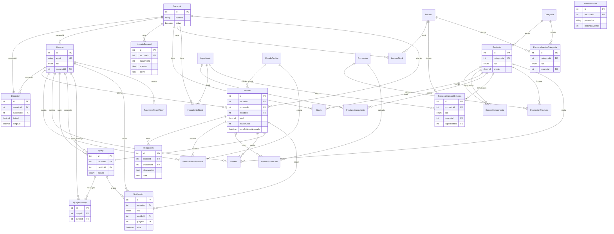

# DER — Comi-Rapi

## 1. Introducción

Este documento describe el **Diagrama Entidad-Relación (DER)** del proyecto **Comi-Rapi** según la implementación real del backend (modelos Sequelize en `lib/models/` y migraciones en `db/migrations/`).

`docs/enunciado.md`, `docs/modelo-dominio.md` y las reglas vigentes siguen siendo fuentes de verdad funcionales; cuando el código y la documentación difieren, este documento refleja el estado actual del código y la diferencia debe resolverse explícitamente. `docs/historico/analisis-inicial.md` es material histórico.

## 2. Entidades implementadas

Entidades/tablas persistentes: `Usuario`, `Direccion`, `Sucursal`, `HorarioSucursal`, `Categoria`, `Producto`, `ComboComponente`, `Stock`, `Insumo`, `InsumoStock`, `Ingrediente`, `IngredienteStock`, `ProductoIngrediente`, `PersonalizacionElemento`, `PersonalizacionCategoria`, `Pedido`, `PedidoItem`, `EstadoPedido`, `PedidoEstadoHistorial`, `Promocion`, `PromocionProducto`, `PedidoPromocion`, `Resena`, `Queja`, `QuejaMensaje`, `Notificacion`, `ParametroSistema`, `PasswordResetToken` y `DistanciaRuta` (caché técnica). El carrito no se persiste.

**Diferencias respecto del DER/modelo abstracto anterior:** no existen en el código `OpcionGrupo`, `Opcion`, `ProductoOpcionGrupo` ni `PedidoItemOpcion`. La personalización se implementa con `PersonalizacionElemento` (por producto) y `PersonalizacionCategoria` (plantilla por categoría) vía `/api/personalizacion`; el snapshot de personalización elegida se guarda en `PedidoItem.observacion` (JSON) y la nota libre en `PedidoItem.nota`. El ítem de pedido es `PedidoItem` (tabla `PedidoItems`, archivo legacy `lib/models/linea_pedido.js`) y el historial es `PedidoEstadoHistorial` (tabla `PedidoEstadoHistorials`, archivo legacy `lib/models/historial_estado_pedido.js`).

### 2.1 Usuario (`Usuarios`)

| Atributo                | Tipo                                                 | Notas                                               |
| ----------------------- | ---------------------------------------------------- | --------------------------------------------------- |
| `id`                    | INTEGER                                              | PK                                                  |
| `nombre`                | STRING                                               | NOT NULL                                            |
| `apellido`              | STRING                                               | NULLABLE                                            |
| `email`                 | STRING                                               | NOT NULL, UNIQUE                                    |
| `password`              | STRING                                               | NOT NULL, hash Argon2id                             |
| `telefono`              | STRING                                               | NULLABLE                                            |
| `rol`                   | ENUM(`CLIENTE`,`ADMINISTRADOR`,`SUPERADMINISTRADOR`) | NOT NULL, default `CLIENTE`                         |
| `activo`                | BOOLEAN                                              | NOT NULL, default `true`                            |
| `fechaNacimiento`       | DATEONLY                                             | NULLABLE                                            |
| `fotoPerfilUrl`         | STRING                                               | NULLABLE                                            |
| `sucursalId`            | INTEGER                                              | FK opcional → `Sucursales.id`, `ON DELETE SET NULL` |
| `createdAt`,`updatedAt` | DATE                                                 | timestamps                                          |

- CHECK en migración: `sucursalId` solo para `ADMINISTRADOR`. `edad` es virtual (no persistida). `toJSON`/serialización pública excluyen `password`.

### 2.2 Direccion (`Direcciones`)

Propietario exclusivo: usuario **o** sucursal.
| Atributo | Tipo | Notas |
|---|---|---|
| `id` | INTEGER | PK |
| `usuarioId` | INTEGER | FK opcional → `Usuarios.id`, `ON DELETE RESTRICT` |
| `sucursalId` | INTEGER | FK opcional → `Sucursales.id`, `ON DELETE RESTRICT` |
| `calle` | STRING | NOT NULL |
| `altura` | INTEGER | NOT NULL |
| `provincia` | STRING | NOT NULL |
| `departamento` | STRING | NULLABLE |
| `localidad` | STRING | NULLABLE |
| `codigoPostal` | STRING | NULLABLE |
| `nomenclatura` | STRING | NULLABLE |
| `referencia` | TEXT | NULLABLE |
| `latitud`,`longitud` | DECIMAL(10,7) | NULLABLE, calculadas por backend (Georef) |
| `alias` | STRING | NULLABLE |
| `activa` | BOOLEAN | NOT NULL, default `true` |

- CHECK `CK_Direcciones_propietario`: exactamente uno entre `usuarioId` y `sucursalId`.

### 2.3 Sucursal (`Sucursales`)

| Atributo   | Tipo    | Notas                    |
| ---------- | ------- | ------------------------ |
| `id`       | INTEGER | PK                       |
| `nombre`   | STRING  | NOT NULL                 |
| `telefono` | STRING  | NULLABLE                 |
| `activa`   | BOOLEAN | NOT NULL, default `true` |

- `1:1` con `Direccion` vía `Direcciones.sucursalId`. No tiene columna `horarios` ni dirección/coordenadas propias.

### 2.3.1 HorarioSucursal (`HorarioSucursales`)

| Atributo     | Tipo    | Notas                                     |
| ------------ | ------- | ----------------------------------------- |
| `id`         | INTEGER | PK                                        |
| `sucursalId` | INTEGER | FK → `Sucursales.id`, `ON DELETE CASCADE` |
| `diaSemana`  | INTEGER | 1=lunes … 7=domingo                       |
| `apertura`   | TIME    | hora real apertura                        |
| `cierre`     | TIME    | hora real cierre                          |

- UNIQUE `(sucursalId, diaSemana, apertura, cierre)`; CHECK día 1..7. `cierre > apertura`: la franja empieza y termina el mismo día (no hay cruce de medianoche). Corte de pedidos derivado de `margenCierreMinutos`.

### 2.4 Categoria (`Categorias`)

| Atributo      | Tipo    | Notas                    |
| ------------- | ------- | ------------------------ |
| `id`          | INTEGER | PK                       |
| `nombre`      | STRING  | NOT NULL, UNIQUE         |
| `descripcion` | TEXT    | NULLABLE                 |
| `imagen`      | STRING  | NULLABLE                 |
| `activa`      | BOOLEAN | NOT NULL, default `true` |

### 2.5 Producto (`Productos`)

| Atributo      | Tipo                     | Notas                          |
| ------------- | ------------------------ | ------------------------------ |
| `id`          | INTEGER                  | PK                             |
| `categoriaId` | INTEGER                  | FK → `Categorias.id`, NOT NULL |
| `nombre`      | STRING                   | NOT NULL                       |
| `descripcion` | TEXT                     | NULLABLE                       |
| `precio`      | DECIMAL(10,2)            | NOT NULL                       |
| `imagen`      | STRING                   | NULLABLE                       |
| `activo`      | BOOLEAN                  | NOT NULL, default `true`       |
| `tipo`        | ENUM(`PRODUCTO`,`COMBO`) | NOT NULL                       |

### 2.6 ComboComponente (`ComboComponentes`)

| Atributo     | Tipo    | Notas                            |
| ------------ | ------- | -------------------------------- |
| `id`         | INTEGER | PK                               |
| `comboId`    | INTEGER | FK → `Productos.id` (combo)      |
| `productoId` | INTEGER | FK → `Productos.id` (componente) |
| `cantidad`   | INTEGER | NOT NULL, default 1, `>= 1`      |

- UNIQUE `(comboId, productoId)`.

### 2.7 Stock (`Stocks`)

| Atributo     | Tipo    | Notas                              |
| ------------ | ------- | ---------------------------------- |
| `sucursalId` | INTEGER | PK compuesta, FK → `Sucursales.id` |
| `productoId` | INTEGER | PK compuesta, FK → `Productos.id`  |
| `cantidad`   | INTEGER | NOT NULL, default 0, `>= 0`        |
| `disponible` | BOOLEAN | NOT NULL, default `true`           |

- PK `(sucursalId, productoId)`. Cantidad de producto/combo es derivada por servicios de stock/receta/componentes.

### 2.8 Insumo (`Insumos`)

| Atributo | Tipo                       | Notas                    |
| -------- | -------------------------- | ------------------------ |
| `id`     | INTEGER                    | PK                       |
| `nombre` | STRING                     | NOT NULL                 |
| `tipo`   | ENUM(`extra`,`condimento`) | NOT NULL                 |
| `precio` | DECIMAL(10,2)              | NULLABLE                 |
| `activo` | BOOLEAN                    | NOT NULL, default `true` |

- UNIQUE `(nombre, tipo)`.

### 2.9 InsumoStock (`InsumoStocks`)

| Atributo     | Tipo    | Notas                              |
| ------------ | ------- | ---------------------------------- |
| `sucursalId` | INTEGER | PK compuesta, FK → `Sucursales.id` |
| `insumoId`   | INTEGER | PK compuesta, FK → `Insumos.id`    |
| `cantidad`   | INTEGER | NOT NULL, default 0, `>= 0`        |
| `disponible` | BOOLEAN | NOT NULL, default `true`           |

### 2.10 Ingrediente (`Ingredientes`)

| Atributo       | Tipo                             | Notas                              |
| -------------- | -------------------------------- | ---------------------------------- |
| `id`           | INTEGER                          | PK                                 |
| `nombre`       | STRING                           | NOT NULL, único (case-insensitive) |
| `unidadMedida` | ENUM(`unidad`,`g`,`kg`,`ml`,`l`) | NOT NULL                           |
| `activo`       | BOOLEAN                          | NOT NULL, default `true`           |

### 2.11 IngredienteStock (`IngredienteStocks`)

| Atributo        | Tipo          | Notas                                |
| --------------- | ------------- | ------------------------------------ |
| `sucursalId`    | INTEGER       | PK compuesta, FK → `Sucursales.id`   |
| `ingredienteId` | INTEGER       | PK compuesta, FK → `Ingredientes.id` |
| `cantidad`      | DECIMAL(12,3) | NOT NULL, default 0, `>= 0`          |
| `disponible`    | BOOLEAN       | NOT NULL, default `true`             |

### 2.12 ProductoIngrediente (`ProductoIngredientes`)

| Atributo        | Tipo          | Notas                                |
| --------------- | ------------- | ------------------------------------ |
| `productoId`    | INTEGER       | PK compuesta, FK → `Productos.id`    |
| `ingredienteId` | INTEGER       | PK compuesta, FK → `Ingredientes.id` |
| `cantidad`      | DECIMAL(12,3) | NOT NULL, `> 0`                      |
| `permiteQuitar` | BOOLEAN       | NOT NULL, default `true`             |

- Receta de productos simples (`tipo=PRODUCTO`).

### 2.13 PersonalizacionElemento (`PersonalizacionElementos`)

| Atributo                | Tipo                                                  | Notas                           |
| ----------------------- | ----------------------------------------------------- | ------------------------------- |
| `id`                    | INTEGER                                               | PK                              |
| `productoId`            | INTEGER                                               | FK → `Productos.id`, NOT NULL   |
| `tipo`                  | ENUM(`extra`,`personalizar`,`acompanar`,`condimento`) | NOT NULL                        |
| `nombre`                | STRING                                                | NULLABLE                        |
| `precio`                | DECIMAL(10,2)                                         | NULLABLE                        |
| `productoReferenciaId`  | INTEGER                                               | FK opcional → `Productos.id`    |
| `insumoId`              | INTEGER                                               | FK opcional → `Insumos.id`      |
| `ingredienteId`         | INTEGER                                               | FK opcional → `Ingredientes.id` |
| `minimo`,`maximo`       | INTEGER                                               | NOT NULL, defaults 0/1          |
| `activo`                | BOOLEAN                                               | NOT NULL, default `true`        |
| `createdAt`,`updatedAt` | DATE                                                  | timestamps                      |

### 2.14 PersonalizacionCategoria (`PersonalizacionCategorias`)

| Atributo                | Tipo                                                  | Notas                          |
| ----------------------- | ----------------------------------------------------- | ------------------------------ |
| `id`                    | INTEGER                                               | PK                             |
| `categoriaId`           | INTEGER                                               | FK → `Categorias.id`, NOT NULL |
| `tipo`                  | ENUM(`extra`,`personalizar`,`acompanar`,`condimento`) | NOT NULL                       |
| `nombre`                | STRING                                                | NULLABLE                       |
| `precio`                | DECIMAL(10,2)                                         | NULLABLE                       |
| `productoReferenciaId`  | INTEGER                                               | FK opcional → `Productos.id`   |
| `insumoId`              | INTEGER                                               | FK opcional → `Insumos.id`     |
| `minimo`,`maximo`       | INTEGER                                               | NOT NULL, defaults 0/1         |
| `activo`                | BOOLEAN                                               | NOT NULL, default `true`       |
| `createdAt`,`updatedAt` | DATE                                                  | timestamps                     |

### 2.15 Pedido (`Pedidos`)

| Atributo                        | Tipo                           | Notas                             |
| ------------------------------- | ------------------------------ | --------------------------------- |
| `id`                            | INTEGER                        | PK                                |
| `usuarioId`                     | INTEGER                        | FK → `Usuarios.id`, NOT NULL      |
| `sucursalId`                    | INTEGER                        | FK → `Sucursales.id`, NOT NULL    |
| `fechaHora`                     | DATE                           | NOT NULL, default `NOW`           |
| `estadoId`                      | INTEGER                        | FK → `EstadoPedidos.id`, NOT NULL |
| `costoEnvio`                    | DECIMAL(10,2)                  | NOT NULL, default 0               |
| `total`                         | DECIMAL(10,2)                  | NOT NULL                          |
| `medioPago`                     | ENUM(`MERCADO_PAGO`,`TARJETA`) | NULLABLE                          |
| `observacion`                   | TEXT                           | NULLABLE                          |
| `calle`,`ciudad`,`codigoPostal` | STRING                         | NULLABLE, snapshot dirección      |
| `altura`                        | INTEGER                        | NULLABLE, snapshot dirección      |
| `referencia`                    | TEXT                           | NULLABLE, snapshot dirección      |
| `latitud`,`longitud`            | DECIMAL(10,7)                  | NULLABLE, snapshot dirección      |
| `etaMinutos`                    | INTEGER                        | NULLABLE                          |
| `etaCalculadoEn`                | DATE                           | NULLABLE                          |
| `horaEstimadaLlegada`           | DATE                           | NULLABLE                          |

### 2.16 PedidoItem (`PedidoItems`)

Modelo `PedidoItem` (`lib/models/linea_pedido.js`).
| Atributo | Tipo | Notas |
|---|---|---|
| `id` | INTEGER | PK |
| `pedidoId` | INTEGER | FK → `Pedidos.id`, NOT NULL |
| `productoId` | INTEGER | FK → `Productos.id`, NULLABLE |
| `nombreProducto` | STRING | NOT NULL, snapshot |
| `precioUnitario` | DECIMAL(10,2) | NOT NULL, snapshot |
| `cantidad` | INTEGER | NOT NULL, default 1 |
| `subtotal` | DECIMAL(10,2) | NOT NULL |
| `observacion` | TEXT | NULLABLE, snapshot personalización (JSON) |
| `nota` | TEXT | NULLABLE, nota para cocina |

### 2.17 EstadoPedido (`EstadoPedidos`)

| Atributo    | Tipo    | Notas                     |
| ----------- | ------- | ------------------------- |
| `id`        | INTEGER | PK                        |
| `nombre`    | STRING  | NOT NULL, UNIQUE          |
| `orden`     | INTEGER | NOT NULL                  |
| `esInicial` | BOOLEAN | NOT NULL, default `false` |
| `esFinal`   | BOOLEAN | NOT NULL, default `false` |
| `activo`    | BOOLEAN | NOT NULL, default `true`  |

### 2.18 PedidoEstadoHistorial (`PedidoEstadoHistorials`)

Modelo `PedidoEstadoHistorial` (`lib/models/historial_estado_pedido.js`).
| Atributo | Tipo | Notas |
|---|---|---|
| `id` | INTEGER | PK |
| `pedidoId` | INTEGER | FK → `Pedidos.id`, NOT NULL |
| `estadoId` | INTEGER | FK → `EstadoPedidos.id`, NOT NULL |
| `usuarioId` | INTEGER | FK → `Usuarios.id`, NULLABLE |
| `fechaHora` | DATE | NOT NULL, default `NOW` |
| `observacion` | TEXT | NULLABLE |

### 2.19 Promocion (`Promociones`)

| Atributo                 | Tipo                                       | Notas                    |
| ------------------------ | ------------------------------------------ | ------------------------ |
| `id`                     | INTEGER                                    | PK                       |
| `nombre`                 | STRING                                     | NOT NULL                 |
| `descripcion`            | TEXT                                       | NULLABLE                 |
| `tipo`                   | ENUM(`DESCUENTO_PORCENTUAL`,`DOS_POR_UNO`) | NOT NULL                 |
| `valor`                  | DECIMAL(10,2)                              | NOT NULL                 |
| `fechaInicio`,`fechaFin` | DATE                                       | NULLABLE                 |
| `activa`                 | BOOLEAN                                    | NOT NULL, default `true` |

### 2.20 PromocionProducto (`PromocionProductos`)

| Atributo      | Tipo    | Notas                           |
| ------------- | ------- | ------------------------------- |
| `id`          | INTEGER | PK                              |
| `promocionId` | INTEGER | FK → `Promociones.id`, NOT NULL |
| `productoId`  | INTEGER | FK → `Productos.id`, NOT NULL   |

- UNIQUE `(promocionId, productoId)`.

### 2.21 PedidoPromocion (`PedidoPromociones`)

| Atributo            | Tipo          | Notas                           |
| ------------------- | ------------- | ------------------------------- |
| `id`                | INTEGER       | PK                              |
| `pedidoId`          | INTEGER       | FK → `Pedidos.id`, NOT NULL     |
| `promocionId`       | INTEGER       | FK → `Promociones.id`, NOT NULL |
| `descuentoAplicado` | DECIMAL(10,2) | NOT NULL, snapshot              |

- UNIQUE `(pedidoId, promocionId)`.

### 2.22 Resena (`Resenas`)

| Atributo                | Tipo    | Notas                         |
| ----------------------- | ------- | ----------------------------- |
| `id`                    | INTEGER | PK                            |
| `usuarioId`             | INTEGER | FK → `Usuarios.id`, NOT NULL  |
| `productoId`            | INTEGER | FK → `Productos.id`, NOT NULL |
| `pedidoId`              | INTEGER | FK → `Pedidos.id`, NOT NULL   |
| `puntuacion`            | INTEGER | NOT NULL, 1..5                |
| `comentario`            | TEXT    | NULLABLE                      |
| `createdAt`,`updatedAt` | DATE    | timestamps                    |

- UNIQUE `(usuarioId, productoId)`, índice `productoId`, CHECK puntuación, FKs `ON DELETE RESTRICT`.

### 2.23 Queja (`Quejas`)

| Atributo                   | Tipo                                                                                              | Notas                               |
| -------------------------- | ------------------------------------------------------------------------------------------------- | ----------------------------------- |
| `id`                       | INTEGER                                                                                           | PK                                  |
| `usuarioId`                | INTEGER                                                                                           | FK → `Usuarios.id`, NOT NULL        |
| `pedidoId`                 | INTEGER                                                                                           | FK → `Pedidos.id`, NOT NULL, UNIQUE |
| `motivo`                   | ENUM(`PEDIDO_INCOMPLETO`,`PRODUCTO_EN_MAL_ESTADO`,`DEMORA_EN_LA_ENTREGA`,`ERROR_DE_COBRO`,`OTRO`) | NOT NULL                            |
| `detalle`                  | TEXT                                                                                              | NOT NULL                            |
| `estado`                   | ENUM(`PENDIENTE`,`EN_REVISION`,`RESUELTA`,`RECHAZADA`,`CERRADA`)                                  | NOT NULL, default `PENDIENTE`       |
| `respuesta`                | TEXT                                                                                              | NULLABLE                            |
| `respondidoPorId`          | INTEGER                                                                                           | FK opcional → `Usuarios.id`         |
| `respondidaEn`,`cerradaEn` | DATE                                                                                              | NULLABLE                            |
| `createdAt`,`updatedAt`    | DATE                                                                                              | timestamps                          |

### 2.24 QuejaMensaje (`QuejaMensajes`)

| Atributo                | Tipo    | Notas                                              |
| ----------------------- | ------- | -------------------------------------------------- |
| `id`                    | INTEGER | PK                                                 |
| `quejaId`               | INTEGER | FK → `Quejas.id`, NOT NULL, `ON DELETE RESTRICT`   |
| `autorId`               | INTEGER | FK → `Usuarios.id`, NOT NULL, `ON DELETE RESTRICT` |
| `contenido`             | TEXT    | NOT NULL                                           |
| `createdAt`,`updatedAt` | DATE    | timestamps                                         |

- Índice por `quejaId`.

### 2.25 Notificacion (`Notificaciones`)

| Atributo                | Tipo                             | Notas                                             |
| ----------------------- | -------------------------------- | ------------------------------------------------- |
| `id`                    | INTEGER                          | PK                                                |
| `usuarioId`             | INTEGER                          | FK → `Usuarios.id`, NOT NULL, `ON DELETE CASCADE` |
| `tipo`                  | ENUM(`PEDIDO`,`QUEJA`,`SISTEMA`) | NOT NULL, default `SISTEMA`                       |
| `titulo`                | STRING(160)                      | NOT NULL                                          |
| `mensaje`               | TEXT                             | NULLABLE                                          |
| `pedidoId`              | INTEGER                          | FK opcional → `Pedidos.id`, `ON DELETE SET NULL`  |
| `quejaId`               | INTEGER                          | FK opcional → `Quejas.id`, `ON DELETE SET NULL`   |
| `leida`                 | BOOLEAN                          | NOT NULL, default `false`                         |
| `leidaEn`               | DATE                             | NULLABLE                                          |
| `createdAt`,`updatedAt` | DATE                             | timestamps                                        |

- Índices `(usuarioId, leida)`, `(usuarioId, createdAt)`, `pedidoId`, `quejaId`.

### 2.26 ParametroSistema (`ParametrosSistema`)

| Atributo      | Tipo    | Notas            |
| ------------- | ------- | ---------------- |
| `id`          | INTEGER | PK               |
| `clave`       | STRING  | NOT NULL, UNIQUE |
| `valor`       | STRING  | NOT NULL         |
| `descripcion` | TEXT    | NULLABLE         |

### 2.27 PasswordResetToken (`PasswordResetTokens`)

| Atributo                | Tipo       | Notas                                             |
| ----------------------- | ---------- | ------------------------------------------------- |
| `id`                    | INTEGER    | PK                                                |
| `usuarioId`             | INTEGER    | FK → `Usuarios.id`, NOT NULL, `ON DELETE CASCADE` |
| `tokenHash`             | STRING(64) | NOT NULL, UNIQUE (SHA-256)                        |
| `expiresAt`             | DATE       | NOT NULL                                          |
| `usedAt`                | DATE       | NULLABLE                                          |
| `invalidatedAt`         | DATE       | NULLABLE                                          |
| `createdAt`,`updatedAt` | DATE       | timestamps                                        |

- Índices `usuarioId`, `expiresAt`, `usedAt`, `invalidatedAt`.

### 2.28 DistanciaRuta (`DistanciasRutas`)

Caché derivada de routing (no entidad de negocio principal).
| Atributo | Tipo | Notas |
|---|---|---|
| `id` | INTEGER | PK |
| `origenLatitud`,`origenLongitud` | DECIMAL(10,7) | NOT NULL (sucursal) |
| `destinoLatitud`,`destinoLongitud` | DECIMAL(10,7) | NOT NULL (entrega) |
| `sucursalId` | INTEGER | FK opcional → `Sucursales.id`, `ON DELETE SET NULL` (metadato) |
| `distanciaMetros` | INTEGER | NOT NULL |
| `duracionSegundos` | INTEGER | NOT NULL |
| `proveedor` | STRING(16) | NOT NULL |
| `calculadoEn` | DATE | NOT NULL |

- UNIQUE `(origenLatitud, origenLongitud, destinoLatitud, destinoLongitud, proveedor)`.

## 3. Relaciones implementadas

| A                      | B                        | Cardinalidad | FK / vínculo                             |
| ---------------------- | ------------------------ | ------------ | ---------------------------------------- |
| Usuario                | Direccion                | 1:N          | `Direcciones.usuarioId`                  |
| Sucursal               | Direccion                | 1:1          | `Direcciones.sucursalId`                 |
| Sucursal               | Usuario                  | 1:N          | `Usuarios.sucursalId`                    |
| Usuario                | Pedido                   | 1:N          | `Pedidos.usuarioId`                      |
| Usuario                | PedidoEstadoHistorial    | 1:N          | `PedidoEstadoHistorials.usuarioId`       |
| Usuario                | Resena                   | 1:N          | `Resenas.usuarioId`                      |
| Usuario                | Queja (autor)            | 1:N          | `Quejas.usuarioId`                       |
| Usuario                | Queja (respondedor)      | 1:N          | `Quejas.respondidoPorId`                 |
| Usuario                | QuejaMensaje             | 1:N          | `QuejaMensajes.autorId`                  |
| Usuario                | Notificacion             | 1:N          | `Notificaciones.usuarioId`               |
| Usuario                | PasswordResetToken       | 1:N          | `PasswordResetTokens.usuarioId`          |
| Sucursal               | HorarioSucursal          | 1:N          | `HorarioSucursales.sucursalId`           |
| Sucursal               | Stock                    | 1:N          | `Stocks.sucursalId`                      |
| Sucursal               | InsumoStock              | 1:N          | `InsumoStocks.sucursalId`                |
| Sucursal               | IngredienteStock         | 1:N          | `IngredienteStocks.sucursalId`           |
| Sucursal               | Pedido                   | 1:N          | `Pedidos.sucursalId`                     |
| Categoria              | Producto                 | 1:N          | `Productos.categoriaId`                  |
| Categoria              | PersonalizacionCategoria | 1:N          | `PersonalizacionCategorias.categoriaId`  |
| Producto(combo)        | ComboComponente          | 1:N          | `ComboComponentes.comboId`               |
| Producto(componente)   | ComboComponente          | 1:N          | `ComboComponentes.productoId`            |
| Producto               | Stock                    | 1:N          | `Stocks.productoId`                      |
| Producto               | ProductoIngrediente      | 1:N          | `ProductoIngredientes.productoId`        |
| Ingrediente            | ProductoIngrediente      | 1:N          | `ProductoIngredientes.ingredienteId`     |
| Producto ↔ Ingrediente | (receta)                 | N:M          | `ProductoIngredientes`                   |
| Producto               | PersonalizacionElemento  | 1:N          | `PersonalizacionElementos.productoId`    |
| Producto               | PedidoItem               | 1:N          | `PedidoItems.productoId`                 |
| Producto               | Resena                   | 1:N          | `Resenas.productoId`                     |
| Producto ↔ Promocion   |                          | N:M          | `PromocionProductos`                     |
| Insumo                 | InsumoStock              | 1:N          | `InsumoStocks.insumoId`                  |
| Insumo                 | PersonalizacionElemento  | 1:N          | `PersonalizacionElementos.insumoId`      |
| Insumo                 | PersonalizacionCategoria | 1:N          | `PersonalizacionCategorias.insumoId`     |
| Ingrediente            | IngredienteStock         | 1:N          | `IngredienteStocks.ingredienteId`        |
| Ingrediente            | PersonalizacionElemento  | 1:N          | `PersonalizacionElementos.ingredienteId` |
| EstadoPedido           | Pedido                   | 1:N          | `Pedidos.estadoId`                       |
| Pedido                 | PedidoItem               | 1:N          | `PedidoItems.pedidoId`                   |
| Pedido                 | PedidoEstadoHistorial    | 1:N          | `PedidoEstadoHistorials.pedidoId`        |
| EstadoPedido           | PedidoEstadoHistorial    | 1:N          | `PedidoEstadoHistorials.estadoId`        |
| Pedido                 | PedidoPromocion          | 1:N          | `PedidoPromociones.pedidoId`             |
| Promocion              | PedidoPromocion          | 1:N          | `PedidoPromociones.promocionId`          |
| Pedido                 | Resena                   | 1:N          | `Resenas.pedidoId`                       |
| Pedido                 | Queja                    | 1:1          | `Quejas.pedidoId` (UNIQUE)               |
| Queja                  | QuejaMensaje             | 1:N          | `QuejaMensajes.quejaId`                  |
| Pedido                 | Notificacion             | 1:N          | `Notificaciones.pedidoId`                |
| Queja                  | Notificacion             | 1:N          | `Notificaciones.quejaId`                 |

## 4. Claves y restricciones destacadas

- **PK compuestas:** `Stock (sucursalId,productoId)`, `InsumoStock (sucursalId,insumoId)`, `IngredienteStock (sucursalId,ingredienteId)`, `ProductoIngrediente (productoId,ingredienteId)`.
- **UNIQUE:** `Usuario.email`, `Categoria.nombre`, `EstadoPedido.nombre`, `ParametroSistema.clave`, `PasswordResetToken.tokenHash`, `ComboComponente(comboId,productoId)`, `PromocionProducto(promocionId,productoId)`, `PedidoPromocion(pedidoId,promocionId)`, `Insumo(nombre,tipo)`, `Resena(usuarioId,productoId)`, `Queja.pedidoId`, `HorarioSucursal(sucursalId,diaSemana,apertura,cierre)`, `DistanciaRuta(origenLat,origenLon,destLat,destLon,proveedor)`.
- **Checks/validaciones:** propietario exclusivo de dirección; `Usuario.sucursalId` solo admin; cantidades/rangos no negativos o válidos (`Stock`, `InsumoStock`, `IngredienteStock`, `ProductoIngrediente`, `ComboComponente`, `Resena`); dominios ENUM de roles, tipos, estados, motivos y unidades.
- **Snapshots:** `Pedido` (dirección, ETA, total/costo), `PedidoItem` (`nombreProducto`, `precioUnitario`, `subtotal`, `observacion` JSON, `nota`), `PedidoPromocion` (`descuentoAplicado`).

## 5. Casos especiales reales

- **Personalización:** `PersonalizacionElemento`/`PersonalizacionCategoria` (no `Opcion*`). `insumoId` aplica a extra/condimento; `ingredienteId` a trazabilidad "Sin X". La selección del cliente no se normaliza en `PedidoItemOpcion`, se serializa en `PedidoItem.observacion`.
- **Stock y receta:** `Stock` por sucursal; recetas en `ProductoIngrediente`; stock real de materia prima en `IngredienteStock`; extras/condimentos en `Insumo`/`InsumoStock`. Cantidades derivadas gestionadas en servicios.
- **Combos:** `Producto.tipo=COMBO` + `ComboComponente`.
- **Pedido:** estado actual en `Pedido.estadoId` + historial en `PedidoEstadoHistorial`; ETA (`etaMinutos`, `etaCalculadoEn`, `horaEstimadaLlegada`) calculada por servicios.
- **Quejas:** `Queja 1:1 Pedido` (UNIQUE) con hilo `QuejaMensaje`.
- **Notificaciones:** persistidas por usuario, con origen opcional a pedido/queja y estado de lectura.
- **DistanciaRuta:** caché técnica recomputable por coordenadas+proveedor.

## 6. Diagrama (Mermaid, vista implementada)

## 7. Observaciones de alineación

- Corregido el desfasaje del DER previo: se eliminaron del diagrama real las entidades no implementadas `OpcionGrupo`, `Opcion`, `ProductoOpcionGrupo` y `PedidoItemOpcion`; se incorporaron `PersonalizacionElemento`, `PersonalizacionCategoria`, `QuejaMensaje` y `DistanciaRuta`; y se documentaron campos reales como `PedidoItem.nota`, `PedidoItem.observacion` (snapshot JSON), ETA de `Pedido`, `Queja.cerradaEn`, `Usuario.fotoPerfilUrl`, etc.
- `linea_pedido.js` y `historial_estado_pedido.js` son nombres legacy de archivo; los modelos/tablas reales son `PedidoItem`/`PedidoItems` y `PedidoEstadoHistorial`/`PedidoEstadoHistorials`.
- `DistanciaRuta` es caché técnica (coordenadas + proveedor), no entidad de negocio con reglas propias más allá de su unicidad/recomputabilidad.
- Cualquier cambio estructural futuro debe actualizar migraciones/modelos y luego este DER, manteniendo consistencia con `docs/modelo-dominio.md` y las reglas aprobadas.
